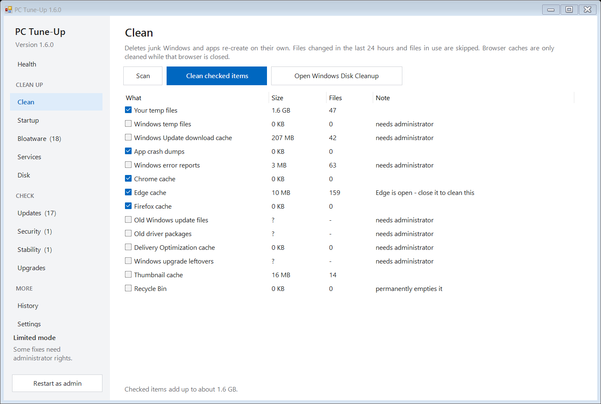
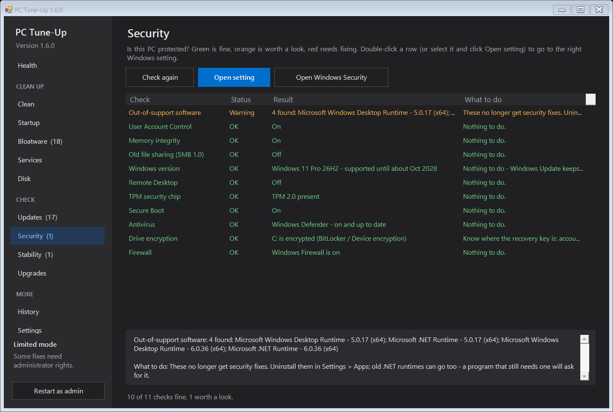
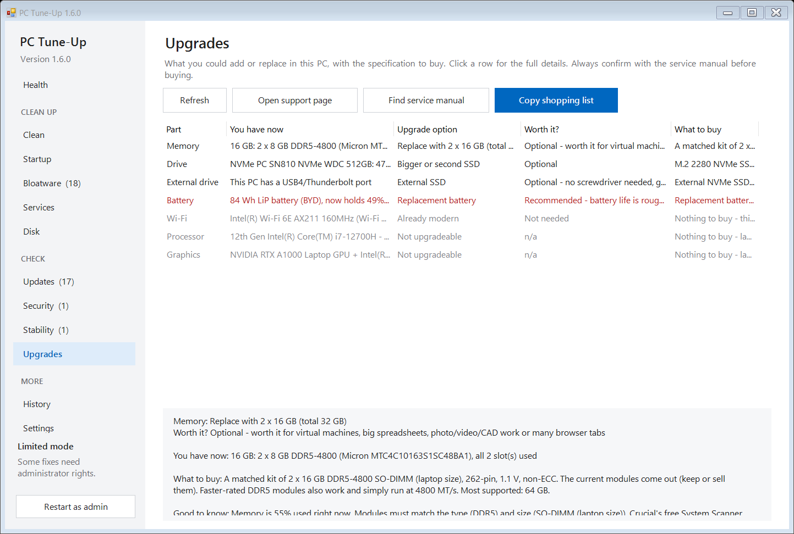

# PC Tune-Up

**Website: https://michaelkloprogge-gif.github.io/pc-tuneup/** (Nederlands: [/nl/](https://michaelkloprogge-gif.github.io/pc-tuneup/nl/))

**Check, clean and speed up any Windows 10/11 PC - whatever the brand - with one click, and undo anything.**



PC Tune-Up is a small, free app for the jobs that make a PC feel new again: clearing junk, stopping
apps that start with Windows, removing pre-installed bloatware, keeping programs up to date, and
spotting what is really wrong (a crashing add-on, a worn battery, a full drive). It explains every
suggestion in plain language, shows you the list before it changes anything, and keeps a history
you can undo.

## What it does

| Page | |
|---|---|
| **Health** | CPU, memory, disk, drive health, battery wear, Windows Update status, power mode, internet speed - and **Fix my PC**, which runs all the safe fixes at once and then shows what changed, before and after - plus **Start here** (the three most useful next steps) and a health score over time |
| **Right now** | what is slowing the PC down at this moment: processor, memory and disk meters, one plain sentence about the biggest cause, the programs using the most with what to do about each, and **End task** (never Windows itself) |
| **Clean** | temp files, crash dumps, browser caches (Chrome, Edge, Brave, Firefox), Windows Update leftovers, old drivers, Windows.old |
| **Startup** | stop apps from launching with Windows, and see how long Windows takes to start (graph) and what slows it down |
| **Bloatware** | find and remove pre-installed junk, trial antivirus and PC-maker extras (Dell, HP, Lenovo, ASUS, Acer, MSI...) |
| **Programs** | every installed program with its size and when you last opened it; uninstall several in one go, leftover folders to the Recycle Bin |
| **Services** | trim background services from PC makers, updaters and telemetry, with one-click restore |
| **Tasks** | scheduled tasks from other companies (updaters, telemetry, promo helpers from Adobe, Google, Zoom, PC makers...) - switch them off with undo |
| **Right-click** | entries other programs add to Explorer's right-click menu - leftovers of removed programs pre-checked; hide with undo |
| **Privacy** | switch off Windows ads, tips and tracking (advertising ID, Start-menu ads, web results in search, lock-screen promos, optional diagnostic data...) with undo |
| **Disk** | see which folders fill the drive, and find large and duplicate files (they only go to the Recycle Bin when you say so; cloud-only OneDrive files are never touched) |
| **Space savers** | hibernation file, reserved storage, Windows file compression, OneDrive copies and Storage Sense - each with what you give up, with undo |
| **Updates** | update outdated programs through winget; safe updates are pre-selected |
| **Drivers** | devices with a problem (Device Manager error codes, explained) and the age of the drivers that matter most: graphics, network, audio, storage, BIOS |
| **Security** | is Windows still supported, can it run Windows 11, are antivirus, firewall, encryption, Secure Boot and TPM on |
| **Browsers** | extensions in Chrome, Edge, Brave, Vivaldi and Firefox, search engine, home page and settings forced by "policies" - the usual places adware hides |
| **Stability** | crashes, freezes, blue screens and errors from the last 30 days, grouped by what really caused them, with one-click fixes (turn off NVIDIA nView, repair Visual C++, reset Windows Update, repair system files, check the drive...) |
| **Network** | Wi-Fi signal and band, delays to the router and the internet, DNS speed, dropped connections, flush DNS and network reset |
| **Gaming** | which graphics card a running game really uses, what else is busy, power mode, Game Mode, background recording and GPU settings - with one-click fixes |
| **Battery** | (laptops) how much charge the battery still holds, a graph of its wear over the years, runtime, and where your PC maker hides the 80% charge limit |
| **Power** | power mode, power plan, screen and sleep timers, the lid, maximum processor speed, USB power saving, hibernate and Fast startup - plugged in and on battery, with one-click fixes that can be undone |
| **Backup** | are Desktop, Documents and Pictures in OneDrive/Dropbox/iCloud, File History, backup programs and restore points - warns when nothing backs up your files |
| **Upgrades** | which memory, drive and battery upgrades fit, the exact specification to buy, and whether it is worth it |
| **History** | every change, with Undo |

**Simple view** (the default for new users) shows one calm screen with a status in plain words and three big buttons - "Show all tools" opens everything below. Security software, VPNs, drivers and databases are never touched, and you can add your own programs
to a keep list. Search everything with Ctrl+F. English, Nederlands, Deutsch and Français, light and dark theme. Settings and choices can be moved to another PC, and Settings > Help and feedback reports a problem with the details already filled in.

**Automatic maintenance** (Settings): every week or every 4 weeks PC Tune-Up cleans junk files and checks the PC
by itself when the PC is idle, and shows a notification when it finds something new. It never changes startup apps, services or programs on its own.

| | |
|---|---|
|  |  |

## Download

Get **PC-TuneUp.exe** from the [latest release](../../releases/latest) and run it (or, once it is accepted into winget: `winget install MichaelKloprogge.PCTuneUp`). It offers to
install itself for you (Start menu, Settings > Apps; no administrator rights needed) and keeps
itself up to date. Without installing, the exe runs as-is from anywhere.

Windows SmartScreen may warn the first time because the exe is not code-signed yet: click
**More info > Run anyway**. (How signing could be added: [docs/SIGNING.md](docs/SIGNING.md).)

Some fixes (Windows' own files, services, restore points) need administrator rights: use
**Restart as admin** in the app.

## Command line

```
PC-TuneUp.exe /report[:file.html]    check everything and save a report (default: Documents)
PC-TuneUp.exe /fix                   run the safe "Fix my PC" steps without asking
PC-TuneUp.exe /auto                  the automatic maintenance run: clean, check, notification
PC-TuneUp.exe /install | /uninstall  install or remove for the current user
```

Use `start /wait PC-TuneUp.exe /report` in a command prompt so it waits for the result.

## Privacy

Everything runs on your PC. PC Tune-Up only goes online to check for its own updates (GitHub), for
the speed test (Cloudflare) and through winget's program list. Nothing about your PC is sent
anywhere. Settings, the change history and the keep list are stored in `%LOCALAPPDATA%\PCTuneUp`.

## How it is built

The app is one PowerShell script (`pc-tuneup.ps1`, Windows Forms) embedded in a tiny C# host, compiled
with the .NET Framework compiler that ships with Windows - nothing to install to build it.

```powershell
.\build-exe.ps1                       # -> dist\PC-TuneUp.exe
.\tests\Test-Upgrades.ps1 -Check      # upgrade advice on made-up PCs
.\tests\Test-Translation.ps1          # Dutch translation
.\tests\Run-Headless.ps1              # run every check on this PC without showing the window
.\tests\Screenshots.ps1 -Out shots    # a PNG of every page
.\publish-release.ps1                 # after bumping $AppVersion and adding a CHANGELOG entry
```

GitHub Actions builds, tests and publishes every release ([workflow](.github/workflows/release.yml)).
See the [changelog](CHANGELOG.md) for what is new. MIT licensed.
